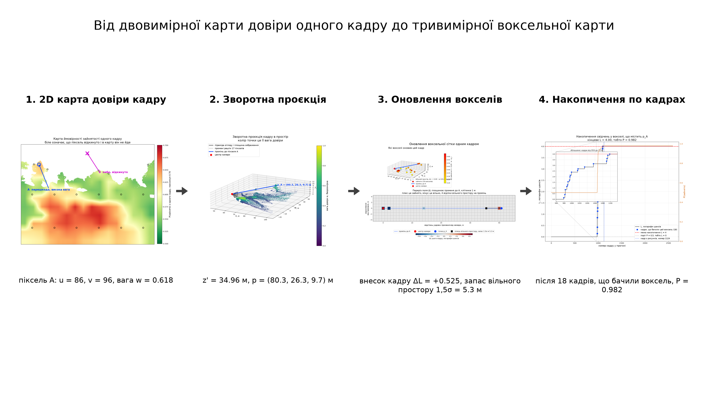
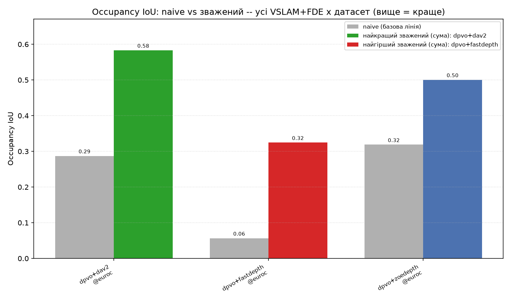
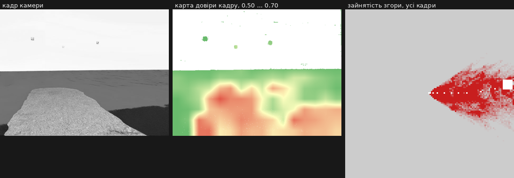

# Локальна ймовірнісна 3D-карта середовища для безпілотника

Бортовий шар безпеки між візуальною локалізацією (VSLAM), оцінкою глибини з
одного зображення (FDE) і автопілотом. Будує локальну воксельну карту
зайнятості, у якій **кожне спостереження додається з вагою довіри**, а не з
однаковою вагою. Магістерська робота, Львівська політехніка.

Головна теза: і VSLAM, і нейромережева глибина помиляються, причому
по-різному. Детермінована карта приймає обидві похибки як факт. Ймовірнісна
дозволяє сказати «тут я не впевнений» і не гальмувати через привид, але й не
проскочити крізь дерево.



---

## Зміст

- [Як це працює](#як-це-працює)
- [Результати](#результати)
- [Реальний час](#реальний-час)
- [Що в репозиторії](#що-в-репозиторії)
- [Як відтворити](#як-відтворити)
- [Відомі обмеження](#відомі-обмеження)

---

## Як це працює

Вхід: кадр камери, щільна карта глибини від FDE, поза камери і розріджені
точки від VSLAM. Вихід: воксельна сітка, де кожна комірка несе ймовірність
бути зайнятою.

**1. Локальне калібрування глибини.** Нейромережева глибина не метрична, і
похибка в ній не стала: на наборі №1 при еталонних 1,76 м модель дає 2,56 м, а
при 48 м дає 25,7 м. Тому глибина калібрується **локально**, плитками 40 на 40
пікселів, по розріджених точках VSLAM, які видно в цьому ж кадрі. Для кожної
плитки шукається своя поправка за дванадцятьма найближчими опорними точками.

**2. Вага довіри.** Для кожного пікселя рахується `w = 1 / (1 + σ / S)`, де
`σ` це оцінка похибки в цьому місці (невідповідність глибини опорним точкам
плюс накопичена похибка пози), а `S` це масштаб, який підлаштовується сам по
історії кадрів, з періодом напіврозпаду 30 оновлень. Жодних еталонних даних
ваги не використовують.

**3. Відкидання неба.** Небо дає глибину, якій вірити не можна. Ознака неба
береться **з самого зображення**: поріг яскравості за Оцу плюс перцентиль
градієнта. Темні або текстуровані пікселі небом бути не можуть.

**4. Накопичення в log-odds.** Кожне спостереження додає `w · l_occ` до
логарифма шансів вокселя, промінь до нього додає `l_free` у порожні комірки.
`l_occ = 0,85`, `l_free = -0,4`, обмеження ±4, як в OctoMap. Один кадр за
побудовою не може підняти ймовірність вище за `сігмоїда(0,85) = 0,70`. Високі
значення накопичуються лише з багатьох кадрів, які підтверджують одне одного.

Докладно з формулами: [`docs/pipeline_method.md`](docs/pipeline_method.md).

---

## Результати

### Карти зайнятості

Головне порівняння: **базова карта** (усі спостереження з вагою 1) проти
**зваженої** (вага довіри). Обидві будуються з однакових входів, однаковою
сіткою, однаковим кодом. Еталон це хмара з еталонної глибини набору.

Зведено по всіх парах з DPVO:

| набір | карта | IoU | FPVR | точність | повнота |
|---|---|---|---|---|---|
| №1 (Isaac Sim) | базова | 0,282 | 0,112 | 0,888 | 0,298 |
| №1 (Isaac Sim) | **зважена** | **0,496** | 0,255 | 0,745 | **0,608** |
| №2–№7 (AirSim) | базова | 0,145 | 0,637 | 0,363 | 0,193 |
| №2–№7 (AirSim) | **зважена** | **0,175** | 0,763 | 0,237 | **0,474** |

Що це означає. Зважування **більш ніж удвічі піднімає повноту**: карта
знаходить удвічі більше справжньої поверхні. Платою є точність і, відповідно,
більше хибних зайнятих вокселів. Для шару безпеки це правильний обмін:
пропустити перешкоду гірше, ніж побачити зайвину. Але це саме обмін, а не
безкоштовне покращення, і в звіті він подається саме так.

Подетально, набір №1:

| пара | IoU база | IoU зважена | FPVR база | FPVR зважена |
|---|---|---|---|---|
| DPVO + ZoeDepth | 0,278 | **0,469** | 0,140 | 0,393 |
| DPVO + Depth Anything V2 | 0,430 | **0,585** | 0,148 | 0,166 |
| DPVO + FastDepth | 0,138 | **0,432** | 0,048 | 0,207 |



На наборах №2–№7 зважена карта краща за базову лише в 11 випадках з 18, і
обидві карти там погані. Причина не в карті, а у вході: див. наступний розділ.

Повна таблиця по всіх 42 комбінаціях: [`maps/all_maps_summary.csv`](maps/all_maps_summary.csv).

### Візуальна локалізація

| набір | DPVO, ATE | DPVO, поз | ORB-SLAM3, ATE | ORB-SLAM3, поз |
|---|---|---|---|---|
| №1 euroc | **0,58 м** | 2593 | 1,67 м | 2307 |
| №2 run1 | 126,9 м | 1251 | 4,37 м | **106** |
| №3 run2 | 140,7 м | 1958 | 4,88 м | **69** |
| №4 run3 | 179,8 м | 1118 | 0,76 м | **26** |
| №5 run4 | 150,4 м | 1177 | 1,59 м | **65** |
| №6 run5 | 151,6 м | 2296 | 4,49 м | **99** |
| №7 run6 | 112,3 м | 1165 | 0,64 м | **42** |

Це і є пояснення поганих карт на №2–№7. Крок між кадрами в наборах AirSim
вийшов близько 1,5 м проти 0,12 м у наборі №1, а DPVO навчався на зсувах від
16 до 72 пікселів. Він дрейфує, але **продовжує видавати пози**, тобто
помиляється тихо. ORB-SLAM3 натомість чесно зупиняється після перших від 26 до
106 кадрів, тому його малий ATE оманливий: він порахований лише на тому
короткому відрізку, який удалось відстежити.

Саме ця різниця і є обґрунтуванням ваги довіри за позою.

### Оцінка глибини

AbsRel, кадри вздовж траєкторії DPVO:

| набір | ZoeDepth | Depth Anything V2 | FastDepth |
|---|---|---|---|
| №1 | **0,80** | 4,00 | 1,25 |
| №2 | 4,90 | 7,96 | **1,88** |
| №3 | 3,84 | 7,56 | **1,50** |
| №4 | 4,20 | 8,73 | **1,69** |
| №5 | 3,55 | 6,38 | **1,46** |
| №6 | 2,88 | 4,88 | **1,38** |
| №7 | 3,28 | 4,93 | **1,41** |

Низький AbsRel у FastDepth оманливий. AbsRel несиметрична: заниження
обмежене одиницею, завищення не обмежене нічим. FastDepth стискає сцену
приблизно в шість разів і тому виграє метрику, програючи по суті. Це видно по
картах: медіанна відстань зайнятих вокселів від траєкторії у FastDepth від 1,5
до 1,8 м проти еталонних від 8 до 15 м.

---

## Реальний час

Той самий конвеєр працює потоково: приймає кадри по мережі, будує карту з
урахуванням усіх попередніх кадрів і віддає назад карту довіри, приріст
вокселів і вектор керування польотом.

```bash
docker start dpvo_live
cd integration
python server_simple.py --raw_jpeg --raw_vector --vector_only \
       --gpu --dpvo --fde dav2_small --queue_frames 1
```

Виміряно на потоці кадрів набору №1 через UDP, відеокарта RTX 4060 Laptop:

| показник | значення |
|---|---|
| затримка від кадру до команди | від 187 до 206 мс |
| довіра після ініціалізації VSLAM | від 0,17 до 0,25 |
| пікселів кадру йде в карту | від 57 до 86 % |
| кадрів до ініціалізації DPVO | 43 |

Живе вікно показує, що саме будується: кадр, карта довіри цього кадру і
накопичена зайнятість згори (`--show_map`).



Деталі протоколу, формат вектора керування і приклади клієнта:
[`integration/README.md`](integration/README.md).

---

## Що в репозиторії

| тека | що там |
|---|---|
| `src/` | конвеєр: калібрування, ваги, воксельна сітка, метрики, візуалізація |
| `integration/` | сервер реального часу і клієнт для того, хто шле кадри |
| `docs/` | метод, журнал роботи, рисунки |
| `comparisons/` | метрики VSLAM і FDE, HTML з траєкторіями і хмарами |
| `maps/` | побудовані карти і зведені таблиці |
| `metric_charts/` | графіки порівнянь |
| `presentation_frames/` | покадровий розбір конвеєра для презентації |

Ключові файли `src/`: `occupancy_3d_map.py` (сітка і ваги),
`realtime_map.py` (потоковий режим), `depth_calibration.py` (локальне
калібрування), `sky_cue.py` (ознака неба), `autopilot.py` (реактивне
планування), `measure_metrics.py` (IoU і FPVR).

---

## Як відтворити

```bash
# 1. оточення
uv venv --python 3.12
source .venv/bin/activate
uv pip install numpy scipy pillow tqdm matplotlib plotly pyyaml evo

# 2. контейнери методів
docker compose build dpvo orbslam3 zoedepth depthanythingv2 fastdepth

# 3. прогін методів на наборі
export DATASET_PATH=~/MasterThesis/datasets/euroc/2026-04-01_12-13-18_000_quadrotor
docker compose run --rm dpvo
docker compose run --rm zoedepth

# 4. метрики VSLAM і FDE, карти, IoU і FPVR
src/compare_all_combos.sh          # метрики VSLAM і FDE -> comparisons/
./build_all_prob_maps.sh           # карти -> maps/, плюс 2D карти ймовірності
python src/measure_metrics.py --n_frames 100000
```

Набори у форматі EuRoC MAV: `cam0/`, `depth0/`, `state_groundtruth_estimate0/`,
часові мітки в наносекундах. Набір №1 знято в NVIDIA Isaac Sim, набори №2–№7 у
Cosys-AirSim на Unreal Engine 5.5.

---

## Відомі обмеження

Перелічено чесно, бо без цього числа вище прочитати неможливо.

1. **Набори №2–№7 треба перезняти.** Задавалось 20 Гц, фактично кадри
   записувались 4 до 5 разів на секунду, бо запит зображення і глибини
   повільніший за цикл симуляції. Звідси крок 1,5 м і звідси дрейф DPVO. Без
   перезапису в покроковому режимі ці набори придатні лише як приклад того, що
   буває, коли VSLAM відмовляє.
2. **Зважена карта піднімає повноту ціною точності.** Це обмін, а не чисте
   покращення, і подавати його треба саме так.
3. **ORB-SLAM3 на №2–№7 відстежує лише перші десятки кадрів.** Його ATE на цих
   наборах порахований на короткому відрізку і не порівнюваний з DPVO напряму.
4. **У реальному часі поза приходить від монокулярного DPVO**, тобто масштаб
   умовний. На борту його треба брати з інерціального модуля або висотоміра.
5. **Фокусна відстань у потоковому режимі** за замовчуванням вгадується як
   0,8 ширини кадру. Для камери з кутом огляду 90° правильно половина ширини,
   тому без `--fov_deg` масштаб карти буде зміщений.
6. **Лопаті гвинтів** у нижніх кутах кадрів AirSim дають глибину від 0,1 до
   0,3 м. Маска є і застосовується лише до тих наборів, де вони справді є.

Журнал роботи з датами, командами і числами:
[`docs/progress.md`](docs/progress.md).
